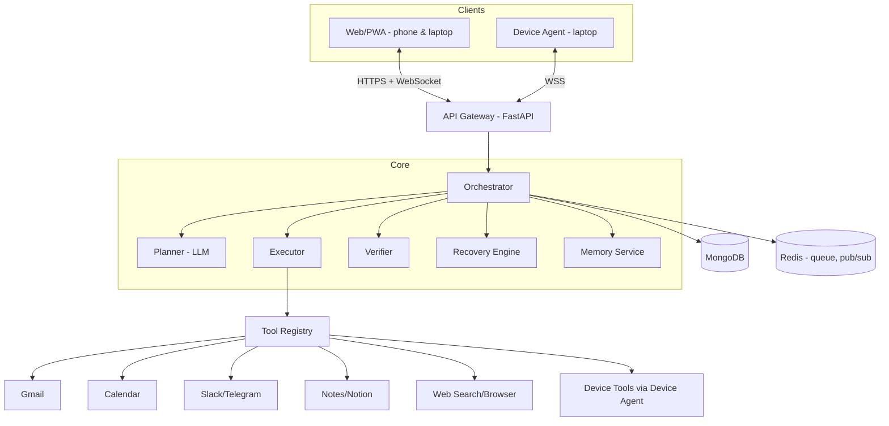

# Jarvis — Personal AI Agent
## Technical Requirements Document (TRD)

| | |
|---|---|
| Version | 0.2 (MongoDB adaptation) |
| Date | 15 Oct 2026 |
| Companion | Jarvis_PRD.md |

> Implementation note: MongoDB replaces the original PostgreSQL/pgvector proposal per the project requirement.
> The current implementation uses FastAPI, PyMongo Async, an in-process leased worker, and a responsive
> browser client. Live mode adds local Ollama planning and Gmail in Brave with exact draft approval;
> bounded WhatsApp in Firefox/Amazon India browser adapters are experimental pending account validation.
> Sandbox connectors remain separate. Redis, Next.js/PWA and OAuth are future work.
> See [README.md](README.md) and [docs/ROADMAP.md](docs/ROADMAP.md) for delivered scope.

---

## 1. Architecture Overview



### Design principles
1. **Plan → Act → Verify → Decide** loop for every step.
2. **Verification is independent** of the action (read back from the app, don't trust the API's 200).
3. **State lives on the server**, clients are views → cross-device for free.
4. **Typed tools**: every tool has a JSON schema, risk tier, and a verifier.
5. **Fail loudly**: unknown = not success.

---

## 2. Tech Stack (proposed)

| Layer | Choice | Reason |
|---|---|---|
| Backend | Python 3.11, FastAPI, asyncio | Fast to build, async I/O for tool calls |
| Orchestration | Custom state machine (or LangGraph) | Explicit control over verify/recover |
| LLM | Provider with tool-calling (e.g. Claude API) | Structured planning + tool use |
| DB | MongoDB + PyMongo Async | Task documents, embedded steps/audit, connections, memory; vector retrieval deferred |
| Queue / PubSub | Redis (+ Arq/Celery worker) | Background execution, real-time events |
| Realtime | WebSocket (FastAPI) | Live sync across devices |
| Web client | Next.js/React PWA | One codebase for phone + laptop |
| Device agent | Python CLI/daemon (pystray optional) | Local file/app actions |
| Browser automation | Playwright | Fallback for apps without API |
| Auth | OAuth 2.0 (Google, Slack), JWT sessions | Standard |
| Secrets | Env vault + Fernet/KMS encryption for tokens | Token safety |
| Observability | OpenTelemetry/structured JSON logs, Langfuse (optional) | Trace each task |
| Deploy | Docker Compose; cloud VM / Railway / Fly.io | Simple |

---

## 3. Component Design

### 3.1 API Gateway
- REST: auth, tasks, connections, devices, history.
- WebSocket `/ws`: pushes task events to all of the user's connected clients.
- Validates JWT, rate-limits per user.

### 3.2 Orchestrator (core loop)

```
receive goal
 → load memory/context
 → PLAN (LLM) → list of steps {id, tool, args, expected_outcome, risk, depends_on}
 → if plan has risky step → await user approval
 → for each ready step:
      ACT      (Executor calls tool)
      VERIFY   (Verifier checks postcondition)
      DECIDE   ok → next | fail → Recovery Engine
 → final report (per-step verified/partial/failed)
```

Guards: max steps (e.g. 15), max replans (2), per-step timeout, token budget.

### 3.3 Planner
- Prompted with tool catalogue (name, description, JSON schema, risk tier), user goal, memory snippets, current time & timezone.
- Output validated against a plan JSON schema; invalid → reprompt once.
- Each step must include `expected_outcome` (natural language) used by the Verifier.

### 3.4 Executor
- Resolves `{{step_2.output.event_id}}`-style references between steps.
- Validates args against the tool schema **before** calling.
- Wraps calls with timeout, retry-safe idempotency keys.
- Routes tools to: local connector, Playwright, or Device Agent over WSS.

### 3.5 Verifier (failure detection core)
Three layers, applied in order:

| Layer | Method | Example |
|---|---|---|
| 1. Protocol check | HTTP status, exceptions, schema of response | 200 + valid `event_id` |
| 2. State read-back | Tool-specific `verify()` queries the app | Fetch event by ID, compare title/time |
| 3. Semantic check (LLM-as-judge, only if 2 is inconclusive) | Compare result vs `expected_outcome` | "Does this summary cover all unread mails?" |

Verdicts: `VERIFIED | PARTIAL | FAILED | UNKNOWN` (**UNKNOWN is treated as failure**).

### 3.6 Failure Taxonomy & Recovery Engine

| Class | Detection | Policy |
|---|---|---|
| TRANSIENT | timeout, 429, 5xx | Retry with exponential backoff + jitter (max 3) |
| AUTH | 401/403, token expired | Try refresh token → else ask user to reconnect |
| INPUT | missing/ambiguous arg, 404 on target | Ask user a targeted question |
| LOGIC | verify() mismatch | Replan with failure context (max 2) |
| LOOP / NO_PROGRESS | repeated identical call, budget exceeded | Halt, report |
| UNRECOVERABLE | permission denied by policy, app down | Abort; rollback completed reversible steps if user agrees |

Task terminal states: `SUCCEEDED | PARTIAL | FAILED | CANCELLED | NEEDS_USER`.

### 3.7 Tool Registry
Each tool implements:

```python
class Tool(Protocol):
    name: str
    description: str
    input_schema: dict          # JSON Schema
    risk: Literal["read", "write_reversible", "write_irreversible"]
    async def run(self, args: dict, ctx: Ctx) -> ToolResult: ...
    async def verify(self, args: dict, result: ToolResult, ctx: Ctx) -> Verdict: ...
    async def undo(self, args: dict, result: ToolResult, ctx: Ctx) -> None: ...  # optional
```

MVP tools:

| Tool | Actions | Risk |
|---|---|---|
| gmail | search, read, summarise, send | read / irreversible |
| calendar | list, create, update, delete | read / reversible |
| slack/telegram | send_message | irreversible |
| notes/notion | create_page, append | reversible |
| web | search, fetch_page | read |
| device.fs | list, move, copy, open | reversible / read |

### 3.8 Memory Service
- **Working memory**: current task context persisted in MongoDB.
- **Long-term**: preferences and facts in MongoDB; vector retrieval is a later design decision.
- Retrieval: top-k by embedding similarity, injected into planner prompt.
- User can list/delete entries (FR-27).

### 3.9 Cross-Device Layer
- Each device registers: `device_id`, type, capabilities, last_seen.
- Clients subscribe to `user:{id}` channel (Redis pub/sub → WebSocket).
- Events are append-only → a late-joining device replays missed events.
- **Device Agent** keeps outbound WSS to the gateway; receives `device_tool_call`, executes within an allow-listed directory, returns result.
- Tool call to an offline device → `NEEDS_USER` / queued with TTL.

### 3.10 Safety & Policy Engine
- Risk tier → confirmation rule:
  - `read` → auto
  - `write_reversible` → auto (configurable confirm)
  - `write_irreversible` → **always confirm** with exact payload preview
- Allow-listed paths for device tools; no shell execution in MVP.
- Prompt-injection defence: content from emails/web is **data, never instructions**; tool calls only originate from planner output; external content wrapped and labelled in prompts.
- Per-task spending/step caps.

---

## 4. Data Model (MongoDB)

Initial collections:

| Collection | Fields / purpose |
|---|---|
| `tasks` | `_id`, goal, scenario, status, embedded steps and audit events, revision, lease owner/expiry, timestamps |
| `artifacts` | Deterministic `task_id:step_id` key, sandbox provider, payload, created_at |
| `devices` | Browser ID, name, capabilities, last_seen; TTL expires inactive sessions |

Each embedded step stores typed tool arguments, dependencies, expected outcome, trusted risk,
status, verdict, attempt count, result/error, and the exact approved payload. Embedded events
record requests, responses, approvals, verification, recovery, and cancellation. A conditional
single-document write atomically checkpoints task state and its audit events using `revision`.

Indexes support task history, status/lease claims, provider lookup, and device expiry. Large
audit payloads and long-lived history will need separate retention/document-size controls.

Planned additional collections: `users`, encrypted OAuth `connections`, `memories`, and a separate
append-only event/audit store when payload volume or retention requires it. These are not yet implemented.

---

## 5. API Specification (MVP)

### REST
| Method | Path | Purpose |
|---|---|---|
| POST | `/auth/login` · `/auth/oauth/{provider}/callback` | Auth / connect apps |
| POST | `/tasks` `{goal}` | Create task → returns `task_id` |
| GET | `/tasks/{id}` | Task + steps + status |
| POST | `/tasks/{id}/approve` `{step_ids|all}` | Approve plan/steps |
| POST | `/tasks/{id}/answer` `{text}` | Answer clarifying question |
| POST | `/tasks/{id}/cancel` | Kill switch |
| POST | `/tasks/{id}/retry` `{step_id}` | Retry failed step |
| GET | `/tasks?cursor=` | History |
| GET/DELETE | `/connections` · `/connections/{id}` | Manage apps |
| GET | `/devices` | Connected devices |
| GET/DELETE | `/memory` · `/memory/{id}` | View/delete memory |

### WebSocket events (server → client)
```json
{"type":"task.plan_ready","task_id":"…","plan":[…]}
{"type":"step.started","step_id":"…"}
{"type":"step.verified","step_id":"…","verdict":"VERIFIED"}
{"type":"step.failed","step_id":"…","class":"AUTH","message":"…","options":["reconnect","skip","cancel"]}
{"type":"approval.required","payload":{…}}
{"type":"task.finished","status":"PARTIAL","report":{…}}
```

### Device channel
```json
→ {"type":"device.call","call_id":"…","tool":"fs.move","args":{…}}
← {"type":"device.result","call_id":"…","ok":true,"data":{…}}
```

---

## 6. Task State Machine

```
CREATED → PLANNING → AWAITING_APPROVAL → RUNNING ⇄ RECOVERING
                                           │
                    ┌──────────┬───────────┼────────────┬───────────┐
                    ▼          ▼           ▼            ▼           ▼
               SUCCEEDED    PARTIAL     FAILED     NEEDS_USER   CANCELLED
```
Step states: `PENDING → RUNNING → VERIFYING → (VERIFIED | FAILED | SKIPPED)`.

---

## 7. Example Flow — UC2 (Schedule + notify)

1. User (phone): "Schedule a meeting with Priya tomorrow 3pm and ping her on Slack."
2. Planner → `calendar.create` → `gmail.send(invite)` (optional) → `slack.send_message`.
3. Plan shown; Slack message flagged irreversible → user approves.
4. `calendar.create` → **verify**: `calendar.get(event_id)` matches title/time ✅
5. `slack.send_message` → **verify**: `conversations.history` contains message ✅
6. Laptop (second device) shows the same live timeline and final report.

Failure variant: step 4 returns 403 → class `AUTH` → refresh token fails → `NEEDS_USER` with "Reconnect Google Calendar"; Slack step **not** executed (dependency unmet); final status `FAILED`, report states exactly why.

---

## 8. Security Requirements

| Area | Requirement |
|---|---|
| Auth | OAuth2 + short-lived JWT, refresh rotation |
| Token storage | Encrypted at rest (Fernet/KMS); never logged |
| Transport | TLS everywhere; WSS only |
| Scopes | Minimum per connector (e.g. `calendar.events`, `gmail.readonly` + `gmail.send` only if enabled) |
| Injection | External content sandboxed in prompts; tool args schema-validated; no free-form shell |
| Device agent | Pairing code + device token; allow-listed directories; revocable |
| Audit | Immutable `tool_calls` + `events` |
| Data deletion | Endpoint to wipe user data & revoke tokens |

---

## 9. Testing & Evaluation

### 9.1 Test layers
| Layer | Approach |
|---|---|
| Unit | Tool schemas, verifier logic, recovery policy table |
| Integration | Connectors against sandbox/test accounts; mock servers |
| E2E | Scripted tasks via API, assert final state in real apps |

### 9.2 Benchmark
~30 tasks across single-app, multi-app, cross-device; track completion %, steps, latency, cost.

### 9.3 Failure-injection suite (must-have)
Fault-injecting proxy around connectors:

| Fault | Expected |
|---|---|
| Timeout / 5xx | Retry, then succeed or report TRANSIENT failure |
| 401 / expired token | Refresh or NEEDS_USER |
| 200 OK but no side-effect (silent failure) | Caught by read-back → FAILED |
| Wrong data written (e.g. wrong time) | Caught by verify → replan |
| Device offline | NEEDS_USER / queued |
| Repeated identical calls | LOOP halt |

**Pass criteria:** 0 false-success reports; ≥ 95 % detection.

---

## 10. Observability

- Trace per task: plan → each step (attempts, latency, verdict) → final report.
- Metrics: task success rate, failure class distribution, verifier disagreement rate, tokens/cost per task, p50/p95 latency.
- Debug view in UI: expandable raw tool I/O (redacted).

---

## 11. Deployment

- Initial `docker compose`: `api` (includes worker and static client), `mongodb`.
- Initial config: `JARVIS_MONGODB_URI`, `JARVIS_MONGODB_DATABASE`, `JARVIS_ACCESS_TOKEN`.
- Later deployment may separate `worker`, `redis`, and `web`; LLM/OAuth/encryption keys are added with real integrations.
- CI: lint + unit tests + failure-injection suite on each push.
- Device agent: packaged as `pip install jarvis-agent` / single binary; pairs via code from web UI.

---

## 12. Implementation Plan

| Week | Tasks |
|---|---|
| 1 | Repo + FastAPI + DB schema; Tool interface; Calendar & Gmail tools; basic planner + executor loop |
| 2 | Verifier (3 layers); failure taxonomy; recovery engine; budgets/loop detection; audit log |
| 3 | Redis pub/sub + WebSocket; Next.js client (plan view, timeline, confirm, failure card); Slack + Notes connectors; OAuth flows |
| 4 | Device agent + pairing; memory service; failure-injection suite; benchmark run; demo script & polish |

---

## 13. Risks (Technical)

| Risk | Mitigation |
|---|---|
| LLM plan quality varies | JSON-schema validation, few-shot examples, replan on failure |
| Verification cost/latency | Prefer deterministic read-back; LLM judge only when needed |
| OAuth app verification delays (Google) | Use test-user mode for demo; mock connectors as fallback |
| Race conditions across devices | Server-authoritative state, append-only events, idempotent endpoints |
| Cost blow-up | Token/step budgets, smaller model for verify/summaries |
| Prompt injection via email/web | Treat content as data; confirm irreversible actions |

---

## 14. Open Technical Decisions

1. Custom orchestrator vs LangGraph?
2. Hosted backend vs local-first (device runs backend)?
3. Which LLM + budget for planner vs verifier?
4. Playwright fallback in MVP or later?
5. Mobile: PWA only, or native wrapper?
